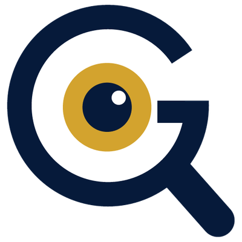
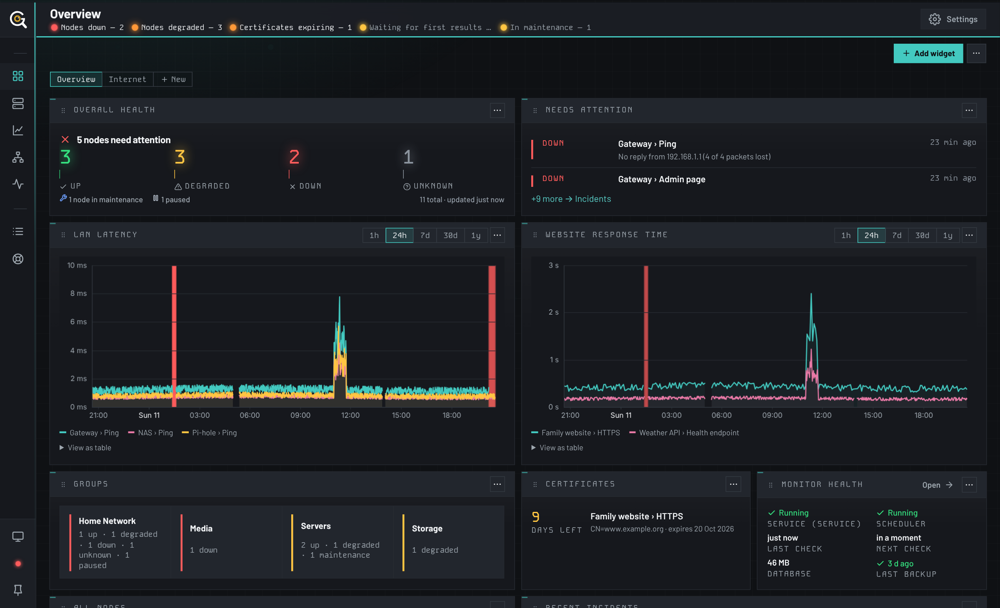

# GWatch

[](https://github.com/jxburros/GWatch/actions/workflows/ci.yml)

GWatch watches your home or small-office network and tells you, calmly, when
something is wrong. It knows which device depends on which, so when the router
dies you get **one alert and a map of what went down with it**, not twenty.

It runs on a computer you own, as a Windows service, a Linux service, a Mac
service or a Docker container, and you use it in a browser at
`http://127.0.0.1:7230`. There is no cloud account, nothing is sent anywhere,
and it is never exposed to the internet unless you arrange that yourself.



> **GWatch is in beta (0.8.11).** It works and it looks after your data, but the
> interface and the JSON API can still change between releases, and bugs are
> likelier now than they will be at 1.0. [`CHANGELOG.md`](CHANGELOG.md) lists
> what is in each version, and the [roadmap](development-docs/productRoadmap.md) what is known to be
> missing. Please [report anything that looks wrong](https://github.com/jxburros/GWatch/issues).

## Contents

- [What it does](#what-it-does)
- [Install](#install)
- [Your first ten minutes](#your-first-ten-minutes)
- [Watching other machines: the agent](#watching-other-machines-the-agent)
- [Is it for you?](#is-it-for-you)
- [Security you should know about](#security-you-should-know-about)
- [Documentation](#documentation)
- [What's new](#whats-new)
- [Contributing and development](#contributing-and-development)
- [Licence, trademarks and credits](#licence-trademarks-and-credits)

## What it does

**Checks the things you care about, on a schedule.**
Ping, websites and APIs (HTTP/S, keyword, JSON values), HTTPS certificates
before they expire, TCP ports, DNS, your own scripts, routers and switches over
SNMP (pick ports by name, no OIDs to look up), Matter smart-home devices, and
the hardware health of any computer you install the small
[agent](#watching-other-machines-the-agent) on, including its Docker containers
and Hyper-V virtual machines.

**Understands what depends on what.**
Say that the NAS is plugged into the office switch and the switch into the
router. When the switch fails, GWatch checks it before blaming the NAS, alerts
you once, and holds back the rest. The **network map** draws those
dependencies, colours them by status and traces the reach of an outage. You can
arrange it by hand, fold parts away, run a **what-if** ("what goes down if this
switch fails?") and present it full screen.

**Alerts without the noise.**
Email, Slack, Teams, Discord, Telegram, Matrix, ntfy, Gotify, Pushover, SMS
(Twilio), PagerDuty or Opsgenie. Alerts wait for a number of failures in a row,
respect cooldowns, silences and maintenance windows, and can be grouped per
node or sent as a digest. **Rules** cover the cases one check cannot: "tell me
when two of my three DNS servers are down".

**Keeps history and shows it well.**
Dashboards you lay out yourself, charts that can lay a metric over its own
earlier days or weeks, an incident timeline, an audit log, and wallboards for a
spare screen. History is rolled up and pruned automatically, so the database
stays small.

**Gets set up quickly.**
Discovery pings a range, shows what answered with its name and open ports, and
adds the devices you tick with a suggested template. Bulk edit changes one
setting across as many nodes as you like.

**Does something about it, if you want.**
Triggers and inbound endpoints can call a webhook, send a notification, run a
git command or run a script when something changes.

**Looks after itself.**
One-click encrypted backups that restore on a new machine in one step. Updates
are signed and verified before they install. Accounts with administrator and
viewer roles, and API keys that are read-only or read-write. Your data lives in
one SQLite file by default, or on your own PostgreSQL or MySQL/MariaDB server.

**Works for everyone.**
The whole interface works from the keyboard and with a screen reader, every
chart has a "view as table", and it comes in dark and light.

## Install

| You have | Do this | Full guide |
|---|---|---|
| **Windows** | Download `gwatch-setup-<version>.exe` from the [latest release](https://github.com/jxburros/GWatch/releases/latest) and run it. It asks for a port and whether other devices on your network may connect, then installs and starts the `GWatch` service. | [`docs/INSTALL.md`](docs/INSTALL.md) |
| **Linux** (Debian, Ubuntu, Raspberry Pi OS, Fedora and relatives) | Download the `.deb` or `.rpm` for your machine from the [latest release](https://github.com/jxburros/GWatch/releases/latest) and install it with `sudo apt install ./gwatch_<version>-1_amd64.deb` or `sudo dnf install ./gwatch-<version>-1.x86_64.rpm`. It runs as its own unprivileged user in a hardened systemd service. Any other systemd distribution: the signed `install.sh`. | [`docs/INSTALL-LINUX.md`](docs/INSTALL-LINUX.md) |
| **Docker** | `docker run -d --name gwatch -p 7230:7230 -v gwatch-data:/data --cap-add NET_RAW ghcr.io/jxburros/gwatch:latest`, or `docker compose up -d` with the [`docker-compose.yml`](docker-compose.yml) here. Then create the first administrator account with the one command in the guide: in a container there is no "this computer" to trust. | [`docs/DOCKER.md`](docs/DOCKER.md) |
| **macOS** | Download `gwatch-darwin-arm64` (Apple silicon) or `gwatch-darwin-amd64` (Intel) from the [latest release](https://github.com/jxburros/GWatch/releases/latest), then `chmod +x` it and run `sudo ./gwatch-darwin-arm64 install` to set it up as a background service. To try it without installing, run `./gwatch-darwin-arm64 run --data-dir ./data`. | `gwatch --help` |

Then open <http://127.0.0.1:7230> on that computer (for Docker,
`http://<the docker host>:7230`).

Windows will warn that the setup program is from an unknown publisher: the
installers are not yet signed with a Windows certificate
([more about that warning](docs/INSTALL.md#known-limitations)). Every release
file is signed with GWatch's own key, and GWatch verifies that signature before
it installs any update.

Want to build it from source instead? See
[`docs/development/DEVELOPMENT.md`](docs/development/DEVELOPMENT.md).

## Your first ten minutes

1. **Open GWatch** and take the short tour it offers.
2. **Add your network.** On **Nodes**, press **Discover**, type your range (for
   example `192.168.1.0/24`), tick the devices you want and add them. Or press
   **Add node** and type a name and an address.
3. **Say what depends on what.** Edit a node and set **Depends on** (the NAS
   depends on the switch, the switch on the router). This is what keeps alerts
   down to one per outage and what the network map draws.
4. **Turn on alerts.** In **Settings**, set up email or one of the other
   channels and send yourself a test.
5. **Make a backup.** **Settings › Backups** takes one click, and it is how you
   move GWatch to another machine later.

The [user guide](docs/USER-GUIDE.md) walks through every screen from there.

## Watching other machines: the agent


`gwatch-agent` is a small program you install on another computer so GWatch can
see its processor, memory, disks, network, services, Docker containers and
Hyper-V machines. In GWatch, choose **Nodes › Add node › A machine with the
GWatch agent**. It shows a short code. Type that code into the agent's Windows
installer, or on Linux and macOS run:

```
gwatch-agent install --server http://<your GWatch computer>:7230 --code XXXX-XXXX
```

The agent starts reporting within a minute and keeps itself up to date from its
own signed releases. It only ever sends readings: GWatch cannot run commands on
the machine through it.

- Use `http://` unless you have put GWatch behind a reverse proxy that provides
  `https://` ([remote access](docs/REMOTE-ACCESS.md)). GWatch itself listens on
  plain HTTP, and it must allow other devices on your network to connect.
- What it can measure differs by system: Linux has the most (temperatures
  included), Windows has no temperatures, and macOS has no processor-use
  reading or temperatures yet. The table is in
  [`docs/HARDWARE.md`](docs/HARDWARE.md).
- An agent can also run GWatch's checks from a second site
  ([remote collectors](docs/COLLECTORS.md)).

## Is it for you?

GWatch sits between the simple uptime checkers and the big network-management
systems.

| | Simple uptime checkers | **GWatch** | Enterprise monitoring suites |
|---|---|---|---|
| Set-up | minutes | minutes | hours to days |
| Checks websites, ports, certificates | yes | yes | yes |
| One alert per outage, not one per device | rarely | **yes** | yes |
| Hardware health of your machines | no | yes, with a small agent | yes |
| Routers and switches (SNMP) | rarely | yes, the common readings | yes, in depth |
| Smart-home (Matter) devices | no | yes | no |
| Runs as a Windows service | rarely | yes | rarely |
| Public status page | usually | **not yet** | sometimes |
| Single sign-on, two-factor sign-in | sometimes | **not yet** | yes |
| Hundreds of notification services | often | twelve, plus webhooks | often |
| Phone app | sometimes | no; the web page works on a tablet, and phones are being improved | sometimes |

It is a good fit if you look after 10 to 100 devices at home or in a small
office and want dependable, quiet alerts with history, on your own hardware. It
is not the right tool if you need a public status page today, sign-in through
your identity provider, or deep SNMP with vendor MIBs.

## Security you should know about

- **Anyone using the computer GWatch runs on is an administrator by default,**
  with no sign-in. That is what makes a fresh install work with no set-up. On a
  shared machine, create an account and turn on **Settings › Users & access ›
  Require sign-in on this computer too**. Background:
  [the local administrator trust model](docs/DISCLAIMER.md#how-gwatch-ships).
- **Other devices cannot connect unless you allow it,** and when you do, they
  have to sign in.
- **GWatch can run scripts** (custom checks and automation). Only an
  administrator signed in at the web page can create those; API keys cannot.
  On Windows the service normally runs as LocalSystem, so treat the
  administrator account accordingly.
- **Do not put GWatch directly on the internet.** Use a VPN or a reverse proxy
  with TLS: [`docs/REMOTE-ACCESS.md`](docs/REMOTE-ACCESS.md).
- **Found a vulnerability?** Please report it privately:
  [`SECURITY.md`](SECURITY.md).

## Documentation

Everything is indexed in [`docs/README.md`](docs/README.md). The ones most
people want:

| | |
|---|---|
| **Using GWatch** | [User guide](docs/USER-GUIDE.md) (start here) · [Recipes for automation](docs/RECIPES.md) · [Troubleshooting](docs/USER-GUIDE.md#20-when-something-is-wrong) |
| **Installing and running** | [Windows](docs/INSTALL.md) · [Linux](docs/INSTALL-LINUX.md) · [Docker](docs/DOCKER.md) · [Backups and moving machine](docs/RESTORE.md) · [Remote access](docs/REMOTE-ACCESS.md) · [PostgreSQL or MySQL](docs/DATABASE.md) |
| **Watching more** | [Hardware and the agent](docs/HARDWARE.md) · [A second site](docs/COLLECTORS.md) · [SNMP](docs/SNMP.md) · [Matter](docs/MATTER.md) |
| **Integrating** | [JSON API](docs/API.md) · [AI assistants (MCP)](mcp/README.md) |
| **Policies** | [Privacy](docs/PRIVACY.md) · [Terms](docs/TERMS.md) · [Disclaimer](docs/DISCLAIMER.md) · [Security](SECURITY.md) |

GWatch has no AI features of its own. The optional, separate MCP companion lets
an assistant *read* your monitoring (and change it only if you allow that); the
set-up guide is in the app under **Settings › AI & MCP**.

## What's new

**0.8.10** fixes a security problem: a request GWatch made to its own address
(an HTTP check or webhook pointed at itself) was treated as the local
administrator, which let a read-write API key do more than it should. If you
have handed out a read-write API key, update. The documentation has also been
reorganised around the person using GWatch.

**0.8.8** rebuilt the network map for big networks: faster layout, dragging
nodes into place, folding clusters, what-if simulation and a presentation mode.

Everything else, version by version: [`CHANGELOG.md`](CHANGELOG.md).

## Contributing and development

Bug reports and ideas are welcome in
[issues](https://github.com/jxburros/GWatch/issues). To build, test or change
GWatch, start with [`CONTRIBUTING.md`](CONTRIBUTING.md); the developer
documents (building and testing, the release process, design decisions) are in
[`docs/development/`](docs/development/README.md), and what is planned is in the
[roadmap](development-docs/productRoadmap.md). AI coding agents start at
[`AGENTS.md`](AGENTS.md), which points to the project's governance documents in
[`development-docs/`](development-docs/coreIdentity.md).

## Licence, trademarks and credits

GWatch is source-available under the [GWatch Community License](LICENSE): free
to use, modify and distribute, including commercially for deployment, support
and customisation work. The unmodified software itself may not be resold or
offered as a paid hosted service. It is not an open-source licence in the OSI
sense. See [`TRADEMARKS.md`](TRADEMARKS.md) for the separate policy on the
GWatch name and logo; forks and derivatives must keep the name, logo and
copyright line visible. The setup program shows the licence and a digest of the
terms, privacy and disclaimer documents before it installs anything.

GWatch is developed by **Jeffrey Guntly** and **Garrett Guntly**, and published
by **JX Holdings, LLC**.

Copyright (c) 2026 JX Holdings. Original developers: Jeffrey Guntly and Garrett Guntly.
