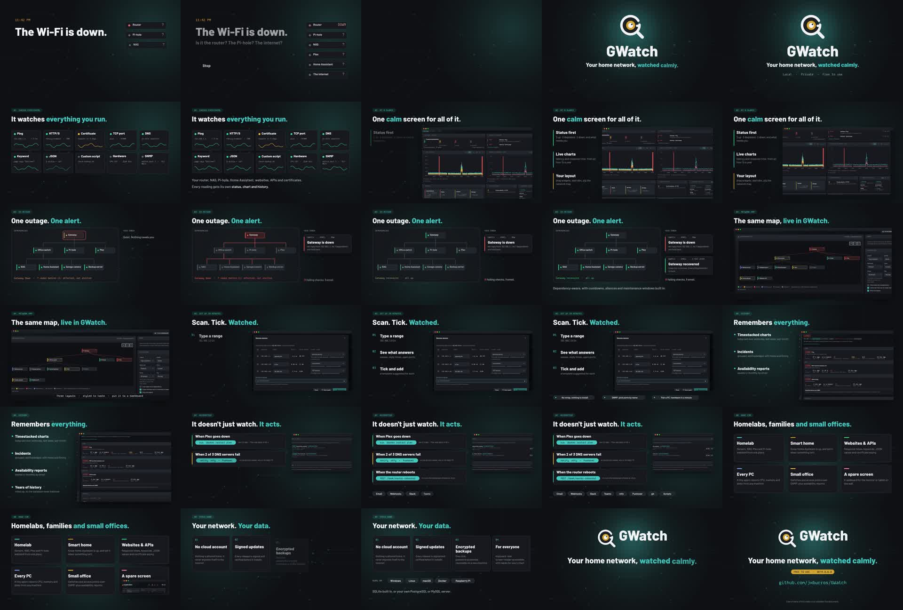

# GWatch in 60 seconds

**Your home network, watched calmly.** A one-minute marketing video for GWatch: what it does, the
interface in action, and what people use it for. It is made with [Vixl](https://github.com/jxburros/Vixl)
like the [beta launch kit](../beta/README.md): every shot is an editable `.vixl` master with a keyframe
timeline, the interface shots are the real GWatch web interface, and the soundtrack is synthesised in code.

**[`gwatch-in-60-seconds.mp4`](gwatch-in-60-seconds.mp4)** · 60.0 s · 1920×1080 · 30 fps · AAC stereo 48 kHz · 5.2 MB



## The cut

| Time | Shot | What it says |
| --- | --- | --- |
| 0:00 | `01-hook` | *11:42 PM. The Wi-Fi is down.* Is it the router? The Pi-hole? The internet? Six devices flicker, then answer: *Stop guessing. Know.* |
| 0:05 | `02-logo` | The magnifier-G pops in and looks around: *GWatch. Your home network, watched calmly.* Local · Private · Free to use |
| 0:09 | `03-checks` | **Checks everything.** Ten cards, one per check type (Ping, HTTP/S, certificate, TCP, DNS, keyword, JSON, custom script, hardware, SNMP), each turning green |
| 0:14 | `04-dashboard` | **At a glance.** The real dashboard pans by: status first, live charts, your own layout |
| 0:19 | `05-outage` | **In action.** *One outage. One alert.* The gateway goes down, the outage's reach turns red through the dependency tree, the seven nodes behind it are held back, and one email arrives; four minutes later, one recovery email. The music drops out with the network and comes back with it |
| 0:28 | `06-map` | **Network map.** The same tree in the real interface |
| 0:32 | `07-discover` | **Set up in minutes.** *Scan. Tick. Watched.* Discovery finds three devices on 192.168.1.0/24, with SNMP port picking and agent pairing |
| 0:37 | `08-history` | **History.** Timestacked charts, incidents, availability reports, years of rolled-up history |
| 0:41 | `09-automation` | **It acts.** Three recipes (restart Plex with `docker restart`, a 2-of-3 DNS rule to ntfy and Pushover, a router-reboot webhook) and the eight ways it notifies or acts |
| 0:47 | `10-uses` | **Made for** homelabs, smart homes, websites and APIs, every PC (the agent), small offices and a spare screen (the wallboard) |
| 0:52 | `11-trust` | **Stays home.** No cloud account, signed updates, encrypted backups, accessible; runs on Windows, Linux, macOS, Docker and Raspberry Pi; SQLite, PostgreSQL or MySQL |
| 0:56 | `12-end` | Lockup, tagline, *Free to use · Beta 0.6.0*, github.com/jxburros/GWatch |

The outage in shot 5 is drawn as Vixl vectors from the interface's demo network (the same nodes and
dependencies the map in shot 6 shows), so it can animate. The recipes in shot 9 match the demo's own
triggers, rule and endpoint, which the screenshot beside them shows.

## Facts on screen

Every claim comes from the 0.6.0 README, CHANGELOG and `docs/`, the same list the beta kit uses
([`../beta/README.md`](../beta/README.md#how-its-built)). If one changes, edit `build/scenes.py`
(`CHECKS`, `RECIPES`, `NOTIFY`, `USES`, `TRUST`, `PLATFORMS`) and rebuild. The version shown on the end
card comes from `VERSION` in `../beta/build.py`. As in the kit, the copy says "free to use", not "open
source": the [GWatch Community License](../../LICENSE) is source-available.

## What is in this folder

| Path | What it is |
| --- | --- |
| `gwatch-in-60-seconds.mp4` | The finished video |
| `contact-sheet.jpg` | One frame every two seconds |
| `scenes/*.vixl` | Twelve editable 1920×1080 masters with keyframe timelines, fonts and screenshots embedded |
| `film-spec.json` | The `film-export` request: shot order, durations and the two-track audio mix |
| `build/kit.py` | Brand, operation builders and motion shorthands. The colours, the mark and the topology field come from `../beta/build.py` |
| `build/scenes.py` | The twelve shots |
| `build/score.py` | A numpy synthesiser: a 120 BPM score in C (I–V–vi–IV) with a cold open, a drop-out for the outage, and effects cued to on-screen events |
| `build/make_video.py` | Builds the scenes, writes `audio/*.wav` (not committed) and runs `film-export` |
| `build/preview.py` | Writes a contact sheet per shot for quick review |
| `screenshots.mjs`, `screens/` | Discovery and automation screenshots from the interface's demo mode (`?mock=1`); the dashboard, map, node and wallboard shots come from `../beta/screens/` |

## Rebuild

You need Python 3.11+, `ffmpeg` on `PATH`, Vixl 0.25+, and network access the first time, when
Vixl downloads Barlow and Kode Mono.

```bash
npm ci                                            # once: Playwright, for the screenshots
node marketing/video/screenshots.mjs              # optional: refresh screens/*.png
python -m pip install 'vixl[pdf] @ https://github.com/jxburros/Vixl/archive/refs/tags/v0.25.0.tar.gz'
python marketing/video/build/make_video.py        # scenes, audio and the MP4 (about 5 minutes on 4 cores)
python marketing/video/build/make_video.py --scenes
cd marketing/video/build && python preview.py /tmp 05 09   # contact sheets for selected shots
```

To change one shot without rebuilding everything, edit its master, for example
`vixl -p marketing/video/scenes/05-outage.vixl render --time 3s --out frame.png`, then run
`vixl workflow film-export --request marketing/video/film-spec.json --workspace marketing/video`.
Re-running `make_video.py` overwrites the masters.
